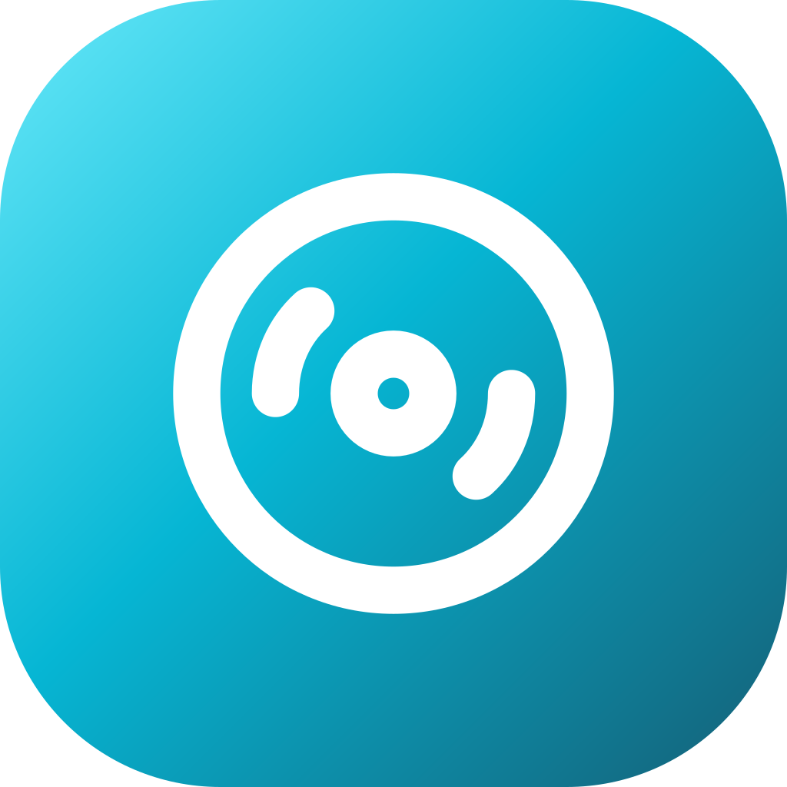
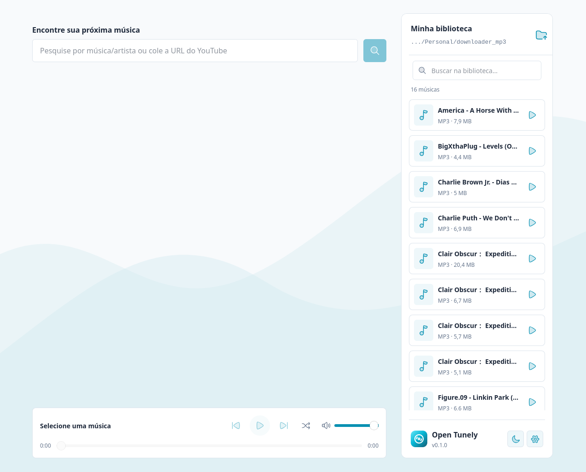
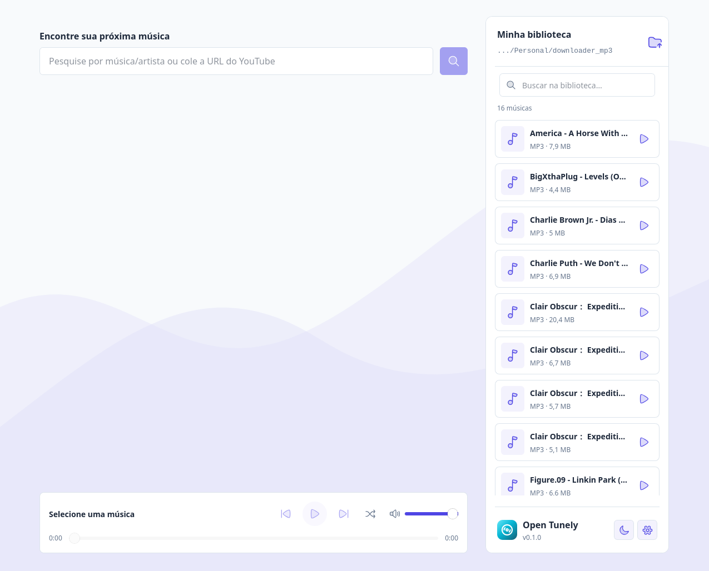
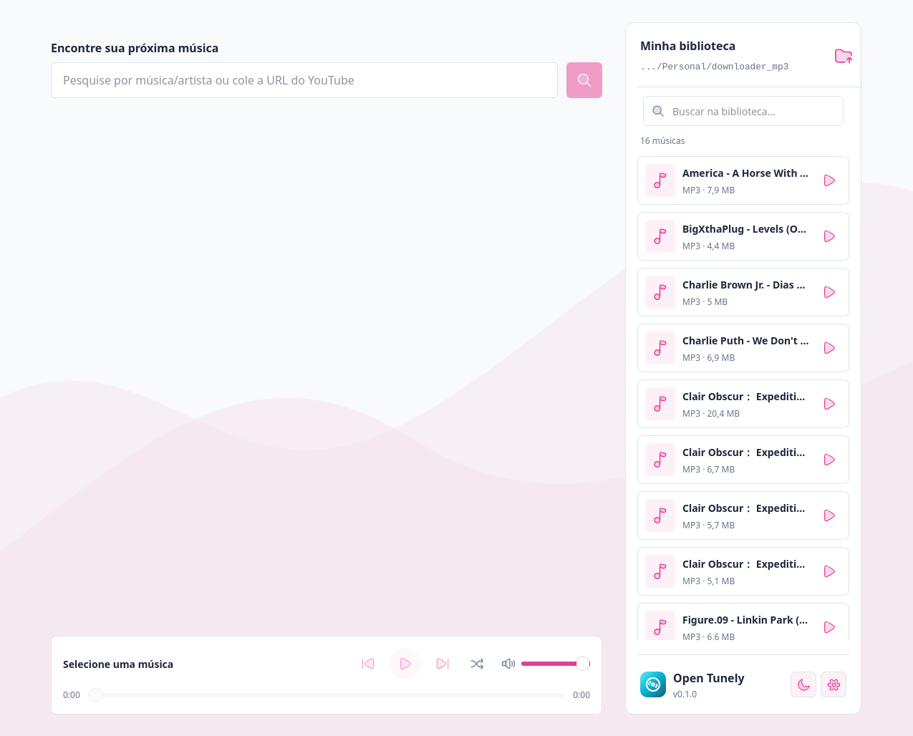
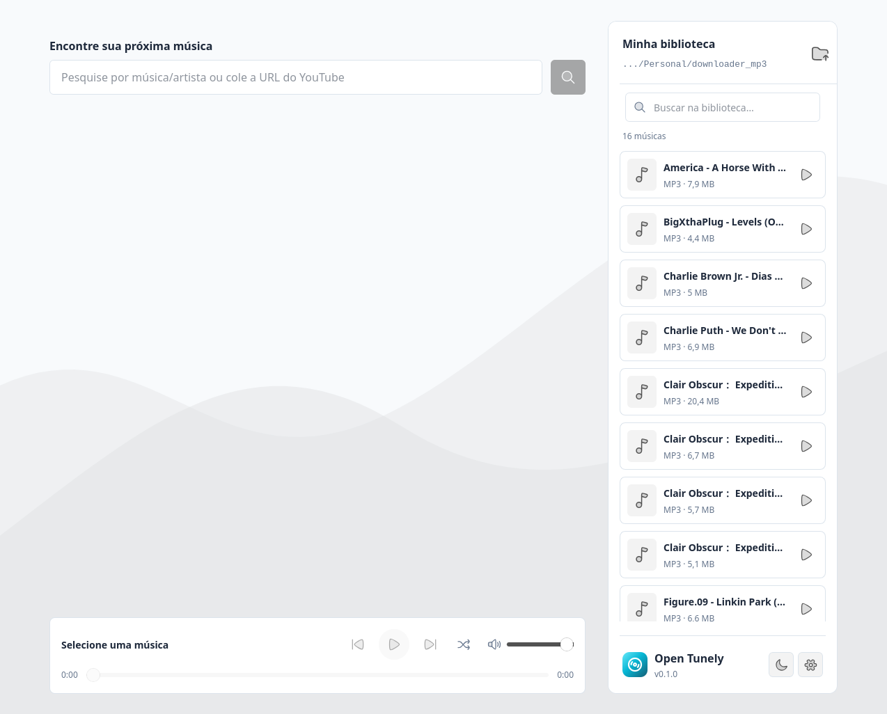

<div align="center">



# Open Tunely Web

**Find it. Download it. Press play.**

A simple, lightweight home for [Open Tunely](https://github.com/guicoelhodev/open-tunely), a free desktop music app.

[](https://svelte.dev/docs/kit)
[](https://svelte.dev/)
[](https://tailwindcss.com/)
[](https://www.typescriptlang.org/)
[](#build-and-deploy)

[Features](#a-direct-path-to-the-app) · [Previews](#the-app-in-four-colors) · [Get started](#get-started) · [Desktop app](https://github.com/guicoelhodev/open-tunely) · [Feedback](https://github.com/guicoelhodev/open-tunely-web/issues)

</div>

## A direct path to the app

- **Download directly.** Windows x64 and Linux x64 downloads link to the desktop app's latest GitHub release.
- **Try the colors.** Cyan, indigo, pink, and neutral accents change both the website palette and the matching app screenshot.
- **Choose your language.** English, Brazilian Portuguese, and Spanish, with a single flag selector. The language preference is saved locally in the browser.
- **Keep it simple.** Short installation instructions, local-file information, and direct access to the source code. No accounts, ads, analytics scripts, or external fonts in the website source.
- **Use it anywhere.** Responsive layouts, keyboard-accessible controls, and transitions that respect reduced-motion preferences.

## The app in four colors

Actual desktop app screenshots, supplied by the author and preserved without cropping or recoloring. These are the images used by the website's theme selector; the app interface in the captures is in Portuguese.

| Cyan | Indigo |
| --- | --- |
|  |  |
| **Pink** | **Neutral** |
|  |  |

## Get started

Use **Node.js 22.12+ or 24+** and npm.

```sh
git clone https://github.com/guicoelhodev/open-tunely-web.git
cd open-tunely-web
npm ci
npm run dev
```

Open the local URL printed by Vite.

## Build and deploy

```sh
npm run check
npm run build
npm run preview
```

`npm run check` runs Svelte and TypeScript diagnostics. The build uses `@sveltejs/adapter-static` and writes the deployable site to **`build/`**. Publish that directory to a static host; no application server or database is required.

The page is prerendered in Brazilian Portuguese. Svelte handles language switching in the browser, including translated metadata and the document's `lang` attribute. Theme and screenshot switching use native radio inputs and CSS.

## Make it your own

| File | Purpose |
| --- | --- |
| [`src/routes/+page.svelte`](src/routes/+page.svelte) | Page layout, download links, language selector, and app previews |
| [`src/lib/translations.ts`](src/lib/translations.ts) | English, Brazilian Portuguese, and Spanish copy |
| [`src/app.css`](src/app.css) | Layout, theme palettes, screenshot transitions, and responsive styles |
| [`static/images/`](static/images/) | Original desktop app screenshots |
| [`static/favicon.svg`](static/favicon.svg) | Open Tunely's original Orbit artwork |

Download URLs use stable filenames under the desktop repository's `releases/latest/download/` endpoint. New desktop releases can be distributed without changing the website, provided those filenames remain the same.

---

Looking for the player itself? Visit the [Open Tunely desktop repository](https://github.com/guicoelhodev/open-tunely).

The desktop app stores MP3s in the user's chosen folder. Search, online previews, and downloads use online services. Download only content you own or have permission to save.

Orbit artwork comes from the desktop project and uses [Lucide](https://lucide.dev/) under its [license](https://github.com/guicoelhodev/open-tunely/blob/master/docs/licenses/lucide.txt).
